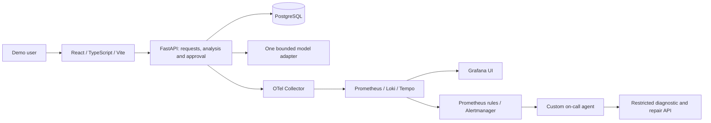

# AI OfficeFlow

AI OfficeFlow is a small **AI-assisted request and task manager** built exclusively for the **DataTalksClub AI Dev Tools Zoomcamp 2026 final project**. The target is demonstrable coverage of all **12 official criteria / 24 available points**, not a commercial platform. No grading points are claimed.

**Status: T01-T11 merged; T12 coverage verified locally.** The authenticated workspace supports requests, bounded analysis, explicit human approval/rejection, persisted tasks and dashboard counts. Local checks pass: 145 backend and 15 browser tests. See [test coverage and commands](docs/testing.md), [T10 real CPU inference evidence](docs/t10-verification.md) and Issue #12 for required CI/merge evidence. Deployment, telemetry and later tasks remain unfinished; no grading points are claimed.

## Run the foundation locally

With Docker Desktop running Linux containers and Python available, generate local configuration once:

```powershell
python scripts/configure_local.py
```

Then start the complete T04 foundation with one command:

```powershell
docker compose up --build
```

Create a controlled account using the command below, open [http://127.0.0.1:8080](http://127.0.0.1:8080), sign in, and use the dashboard or request register. Open **System health** and click **Save synthetic check** to verify UI → API → PostgreSQL → UI. API docs: [http://127.0.0.1:8000/api/docs](http://127.0.0.1:8000/api/docs). Only loopback ports are published; PostgreSQL and operations routes are excluded from the frontend proxy. Public HTTPS deployment remains T16.

```powershell
docker compose --profile test run --build --rm test
python scripts/verify_persistence.py
```

Current local results: **145 backend tests passed** against isolated PostgreSQL and **15 browser checks passed** in installed Edge. Synthetic foundation/request rows and sessions survived earlier db/API restart checks. Historical clean tracked-source startup is recorded in [T04 evidence](docs/t04-verification.md); see [testing instructions](docs/testing.md) and Issue #12 for current commands and CI evidence.

## Problem and expected behavior

Unstructured requests leave people manually deciding what work to do and how urgent it is. AI OfficeFlow gives a demonstration user one place to capture a request, inspect suggested tasks and priorities, approve or reject the suggestions, and track approved work.

Example: enter a synthetic request, “Prepare the meeting room and presentation for Friday.” The analysis agent proposes tasks such as checking equipment and preparing slides, each with `low`, `medium` or `high` priority and a short reason. The suggestions remain inactive until a user approves them. Rejection creates no tasks. Approved tasks are saved in PostgreSQL and appear on the dashboard after refresh/restart.

## MVP

1. Create and view requests containing a title and description.
2. Analyze a request with one bounded AI agent that proposes tasks and priorities.
3. Approve or reject the complete suggestion set.
4. Persist approved tasks and mark them open/done.
5. Display requests, tasks, analysis outcomes and statuses on a dashboard.
6. Use synthetic demonstration data only.

The application has a small authenticated shared demo workspace. Company onboarding, sector-specific fields, sales workflows, owners, deadlines, request editing/revision history, multi-tenancy, enterprise roles, external integrations and autonomous business actions are outside scope. Earlier company assumptions A01–A06 are retired in the [specification](docs/specification.md#retired-assumptions).

## Minimal architecture



Use ordinary Python orchestration for one structured analysis call; no LangGraph, separate business-agent team, worker queue or broker is required. The deterministic stub supports offline startup/tests and is visibly labeled simulated. A separately authorized real model evaluation is required before claiming the AI feature complete. No live provider, API spend or paid hosting is selected.

Docker Compose will start the full demonstration stack with one command. GitHub Actions will run tests on PRs, automatically deploy tested releases to development, and expose a manual production promotion. Development and production contain only synthetic data. A small read-only MCP tool and coding subagent support the Extension Pack; MCP is not an extra mandatory business-service hop.

## Documentation and tracker

- [Specification and measurable acceptance criteria](docs/specification.md)
- [Verified local foundation commands](docs/development.md) and [T04 verification record](docs/t04-verification.md)
- [Minimal architecture](docs/architecture.md) and [ADR index](docs/adr/README.md)
- [Roadmap](docs/plan.md) and [T01–T18 backlog](docs/backlog.md)
- [Coding-agent team](docs/agent-team.md) and [AGENTS.md](AGENTS.md)
- [Permissions](docs/permissions.md)
- [Grading checklist](docs/grading-checklist.md) and [Module 5 checklist](docs/module5-checklist.md)
- [Public repository](https://github.com/chakirou18/AI-OfficeFlow) and [issue tracker](https://github.com/chakirou18/AI-OfficeFlow/issues)

The foundation commands above are verified; later feature/operational commands remain planned until tested. The grading checklist distinguishes T04 evidence from the unfinished full application. The full target includes correlated stored metrics/traces/logs, a user-impact alert, and an automatically triggered on-call agent that actually repairs a controlled incident. These have not been demonstrated. No GitHub Actions workflow or public deployment is included in T04.

All seven Module 5 Agent Extension Pack requirements remain required; Module 5 has no separate graded homework. **Three peer reviews are mandatory to pass**, independently of the project score. Deployment URLs, CI badges, test results and demonstration recordings will be added only after they exist.

CI runs backend lint/unit/PostgreSQL integration tests and frontend lint/typechecked
builds on pull requests and main. Both jobs are required for merging. See
[CI workflow](.github/workflows/ci.yml) and [CI commands](docs/development.md#continuous-integration-t05).
Deployment automation remains T16.

Controlled demo login is now required for the foundation write/read flow. Create accounts
from a trusted terminal with `docker compose exec api python -m app.manage_users create demo_user`.
See [authentication setup and boundaries](docs/development.md#controlled-demo-authentication-t06).
No default password or public signup is provided.

The authenticated [request/task API](docs/development.md#request-and-task-api-t07)
now supports immutable request creation, pagination/detail and persisted task open/done
updates. Request-management UI, analysis and human approval remain later tasks.


T08 browser verification: `python scripts/test_browser.py` starts a separate test-only Compose project, seeds guarded synthetic fixtures and runs Playwright. See [the isolated browser setup](docs/development.md#request-workspace-and-isolated-browser-tests-t08).


T09 adds an **offline, simulated analysis API** with persisted attempts, a 30-second
deadline, explicit retry and schema-validated inactive proposals. A local read-only MCP
stdio tool returns bounded synthetic request summaries. No live model calls or task
approval is implemented. See [analysis and MCP usage](docs/development.md#bounded-offline-analysis-and-read-only-mcp-t09).
