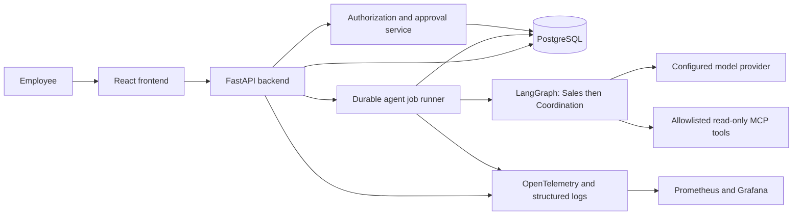

# AI OfficeFlow

AI OfficeFlow is a planned, production-oriented administrative workflow platform for small and medium-sized businesses. It is being developed for the **DataTalksClub AI Dev Tools Zoomcamp 2026 final project**.

**Current status: documentation phase.** There is no application, dependency installation, test result, deployment, or operational evidence yet. All architecture and technology choices below are proposals unless explicitly recorded otherwise.

## Problem

Customer requests often arrive as incomplete, unstructured messages. Employees must interpret them, collect missing details, assign work, and follow up across disconnected tools. This creates repetitive work, inconsistent handoffs, and limited visibility into progress.

The first intended pilot is **Entropie Energies**, operating in energy and photovoltaics. Pilot workflows and sample data still require validation with the business. The core model will use configurable business profiles rather than hard-coded energy-sector rules.

## Proposed solution and users

AI OfficeFlow will turn customer requests into structured, reviewable proposals. Employees retain authority over decisions and consequential actions.

| User | Intended benefit |
| --- | --- |
| Sales or administrative employee | Capture requests, identify missing information, and review suggested next steps |
| Coordinator or manager | Approve proposals, assign work, and track status and deadlines |
| Administrator | Manage access and business configuration |
| Operator | Monitor user impact and investigate failures |

## MVP

1. Create, list, view, and track customer requests.
2. Run an **AI Sales Agent** to extract structured details and flag missing information.
3. Run an **AI Coordination Agent** to propose tasks, owners where known, deadlines, and next steps.
4. Require an authorized employee to approve or reject proposals before tasks or request changes take effect.
5. Show requests, statuses, pending approvals, and agent activity in a dashboard.

The MVP uses manually entered text, one pilot business per deployment, and internal tasks. Automated email, CRM writes, quotes, payments, autonomous scheduling, attachments, and enterprise multi-tenancy are outside the initial scope. Suggested deadlines are advisory and require review.

## Proposed architecture

LangGraph is the initial orchestration candidate; DeepAgents remains an alternative to evaluate. Docker Compose will support local services, GitHub Actions will run checks and deployment workflows, and a constrained on-call agent will demonstrate recovery from a controlled failure. None of these components exists yet.

## Documentation

- [Specification and acceptance criteria](docs/specification.md)
- [Architecture and data flow](docs/architecture.md)
- [Incremental implementation roadmap](docs/plan.md)
- [Numbered backlog and dependencies](docs/backlog.md)
- [Coding-agent team](docs/agent-team.md)
- [Permissions and approval boundaries](docs/permissions.md)
- [Development conventions](AGENTS.md)

## Development and delivery

There are no runnable commands yet. Proposed commands and conventions are in [AGENTS.md](AGENTS.md); they must be implemented and verified before being advertised as working.

The roadmap targets all twelve stated assessment areas, including a public issue tracker, automated tests, public deployment, user-impact alerting, and an on-call demonstration. The assessment mapping is provisional until checked against the official 2026 rubric. The Module 5 Agent Extension Pack has a dedicated roadmap checkpoint; its exact requirements must also be verified before implementation.

The [public repository](https://github.com/chakirou18/AI-OfficeFlow) and [GitHub issue tracker](https://github.com/chakirou18/AI-OfficeFlow/issues) are available. Tasks T01–T18 are linked in the [backlog](docs/backlog.md), with acceptance criteria, dependencies, phase milestones, and a documented status workflow. Application implementation remains planned. Deployment URLs, CI badges, demonstration recordings, and measured results must be added only after they exist. Use synthetic data for public demonstrations and never commit credentials or customer information.
