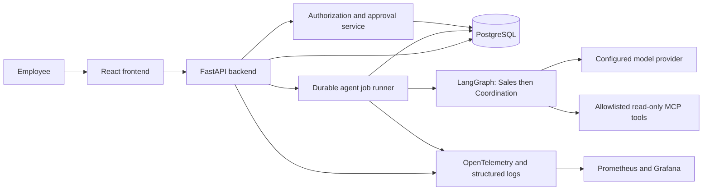

# AI OfficeFlow

AI OfficeFlow is a planned, production-oriented administrative workflow platform for small and medium-sized businesses. It is being developed for the **DataTalksClub AI Dev Tools Zoomcamp 2026 final project**.

**Current status: governance and architecture design.** T01/T02 reviews are complete for a generic synthetic-only prototype; the [ADRs](docs/adr/README.md) record preliminary technical choices and unresolved approval gates under T03. No application, dependency installation, passing application tests, deployment or operational evidence exists yet.

## Problem

Customer requests often arrive as incomplete, unstructured messages. Employees must interpret them, collect missing details, assign work, and follow up across disconnected tools. This creates repetitive work, inconsistent handoffs, and limited visibility into progress.

**Entropie Energies**, operating in energy and photovoltaics, is a proposed pilot use case. The product owner has chosen a generic SME prototype using synthetic data only. All six pilot assumptions remain provisional; no Entropie business workflow is approved and no real company system will be connected. Real customer data and operational fault-injection authorization are deferred. The core model uses configurable business profiles rather than hard-coded energy-sector rules.

## Proposed solution and users

AI OfficeFlow will turn customer requests into structured, reviewable proposals. Employees retain authority over decisions and consequential actions.

| User | Intended benefit |
| --- | --- |
| Sales or administrative employee | Capture requests, identify missing information, and review suggested next steps |
| Coordinator or manager | Approve proposals, assign work, and track status and deadlines |
| Administrator | Manage access and business configuration |
| Operator | Monitor user impact and investigate failures |

## MVP

1. Create, list, view, and track customer requests.
2. Run an **AI Sales Agent** to extract structured details and flag missing information.
3. Run an **AI Coordination Agent** to propose tasks, owners where known, deadlines, and next steps.
4. Require an authorized employee to approve or reject proposals before tasks or request changes take effect.
5. Show requests, statuses, pending approvals, and agent activity in a dashboard.

The MVP uses manually entered text, one pilot business per deployment, and internal tasks. Automated email, CRM writes, quotes, payments, autonomous scheduling, attachments, and enterprise multi-tenancy are outside the initial scope. Suggested deadlines are advisory and require review.

## Proposed architecture

The preliminary design selects React/TypeScript/Vite, FastAPI, PostgreSQL and a bounded LangGraph workflow with read-only MCP tools. A deterministic model stub is the default; no live provider/model or spending budget is approved. Docker Compose will support local services; GitHub Actions will target automatic dev deployment and manual production promotion. OpenTelemetry, Prometheus, Loki, Tempo and Grafana will collect/store/display correlated signals. A constrained alert-driven recovery demonstration is designed but requires later exercise authorization. None of these runtime components exists yet; public hosting remains an approval gate.

## Documentation

- [Specification and acceptance criteria](docs/specification.md)
- [Architecture and data flow](docs/architecture.md)
- [Architecture decision records](docs/adr/README.md)
- [Incremental implementation roadmap](docs/plan.md)
- [Numbered backlog and dependencies](docs/backlog.md)
- [Coding-agent team](docs/agent-team.md)
- [Permissions and approval boundaries](docs/permissions.md)
- [Official grading criteria and evidence status](docs/grading-checklist.md)
- [Module 5 Agent Extension Pack checklist](docs/module5-checklist.md)
- [Development conventions](AGENTS.md)

## Development and delivery

There are no runnable commands yet. Proposed commands and conventions are in [AGENTS.md](AGENTS.md); they must be implemented and verified before being advertised as working.

The roadmap targets the official **12 criteria / 24 points**: Problem Description, Product Specification, Agent Team Specification, Context Management, Application, Testing, Containerization, Deployment, CI/CD, Observability, Alerting on User Impact, and On-Call Agent. The [grading checklist](docs/grading-checklist.md) maps required evidence to public tasks and distinguishes inspected documentation from unverified runtime behavior. Full-score delivery includes one-command startup and tests, automatic dev deployment plus manual production deployment, correlated telemetry stored and visible in a UI, and an alert-driven repair demonstration. No score is claimed.

Module 5 has no separate graded homework; its seven-item [Agent Extension Pack](docs/module5-checklist.md) must be carried into the final project. **Reviewing three other projects is mandatory to pass**, independently of project points. Peer reviews and the Extension Pack demonstration remain unfinished. Official sources are pinned in the checklists; course-platform assignments and deadlines still need checking.

The [public repository](https://github.com/chakirou18/AI-OfficeFlow) and [GitHub issue tracker](https://github.com/chakirou18/AI-OfficeFlow/issues) are available. Tasks T01–T18 are linked in the [backlog](docs/backlog.md), with acceptance criteria, dependencies, phase milestones, and a documented status workflow. Application implementation remains planned. Deployment URLs, CI badges, demonstration recordings, and measured results must be added only after they exist. Use synthetic data for public demonstrations and never commit credentials or customer information.
