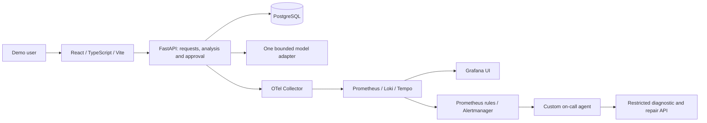

# AI OfficeFlow

AI OfficeFlow is a small **AI-assisted request and task manager** built exclusively for the **DataTalksClub AI Dev Tools Zoomcamp 2026 final project**. The target is demonstrable coverage of all **12 official criteria / 24 available points**, not a commercial platform. No grading points are claimed.

**Status: documentation and design only.** The public repository, 18-issue tracker, rubric audit and earlier ADRs exist. There is no application, installed project dependency, passing application test, deployed service or operational demonstration yet.

## Problem and expected behavior

Unstructured requests leave people manually deciding what work to do and how urgent it is. AI OfficeFlow gives a demonstration user one place to capture a request, inspect suggested tasks and priorities, approve or reject the suggestions, and track approved work.

Example: enter a synthetic request, “Prepare the meeting room and presentation for Friday.” The analysis agent proposes tasks such as checking equipment and preparing slides, each with `low`, `medium` or `high` priority and a short reason. The suggestions remain inactive until a user approves them. Rejection creates no tasks. Approved tasks are saved in PostgreSQL and appear on the dashboard after refresh/restart.

## MVP

1. Create and view requests containing a title and description.
2. Analyze a request with one bounded AI agent that proposes tasks and priorities.
3. Approve or reject the complete suggestion set.
4. Persist approved tasks and mark them open/done.
5. Display requests, tasks, analysis outcomes and statuses on a dashboard.
6. Use synthetic demonstration data only.

The application has a small authenticated shared demo workspace. Company onboarding, sector-specific fields, sales workflows, owners, deadlines, request editing/revision history, multi-tenancy, enterprise roles, external integrations and autonomous business actions are outside scope. Earlier company assumptions A01–A06 are retired in the [specification](docs/specification.md#retired-assumptions).

## Minimal architecture

Use ordinary Python orchestration for one structured analysis call; no LangGraph, separate business-agent team, worker queue or broker is required. The deterministic stub supports offline startup/tests and is visibly labeled simulated. A separately authorized real model evaluation is required before claiming the AI feature complete. No live provider, API spend or paid hosting is selected.

Docker Compose will start the full demonstration stack with one command. GitHub Actions will run tests on PRs, automatically deploy tested releases to development, and expose a manual production promotion. Development and production contain only synthetic data. A small read-only MCP tool and coding subagent support the Extension Pack; MCP is not an extra mandatory business-service hop.

## Documentation and tracker

- [Specification and measurable acceptance criteria](docs/specification.md)
- [Minimal architecture](docs/architecture.md) and [ADR index](docs/adr/README.md)
- [Roadmap](docs/plan.md) and [T01–T18 backlog](docs/backlog.md)
- [Coding-agent team](docs/agent-team.md) and [AGENTS.md](AGENTS.md)
- [Permissions](docs/permissions.md)
- [Grading checklist](docs/grading-checklist.md) and [Module 5 checklist](docs/module5-checklist.md)
- [Public repository](https://github.com/chakirou18/AI-OfficeFlow) and [issue tracker](https://github.com/chakirou18/AI-OfficeFlow/issues)

All startup/test commands are still **planned**, not working instructions. The grading checklist links the pinned official sources and distinguishes documentary evidence from unverified runtime requirements. The full target includes correlated stored metrics/traces/logs, a user-impact alert, and an automatically triggered on-call agent that actually repairs a controlled incident. These have not been demonstrated.

All seven Module 5 Agent Extension Pack requirements remain required; Module 5 has no separate graded homework. **Three peer reviews are mandatory to pass**, independently of the project score. Deployment URLs, CI badges, test results and demonstration recordings will be added only after they exist.
