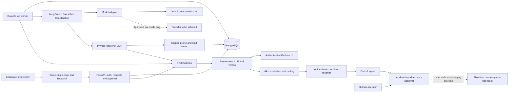
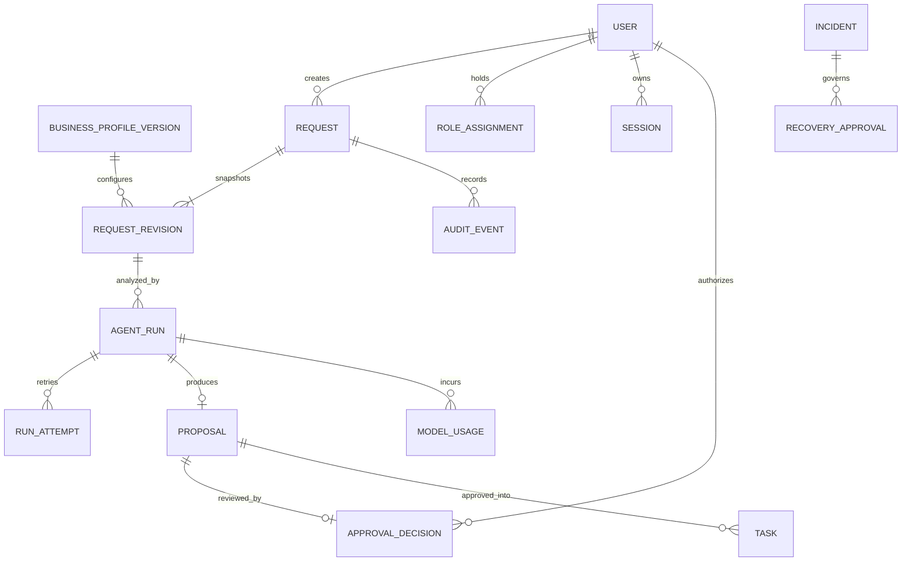

# Technical architecture

Owner: [T03 / Issue #3](https://github.com/chakirou18/AI-OfficeFlow/issues/3). Status: **design only**. No application, services, schema, tests, provider calls, telemetry, deployment or operational exercise exists. [ADRs](adr/README.md) record preliminary choices and explicit approval gates.

## Product boundary and decision status

Build a generic SME workflow platform using synthetic data only. Entropie Energies is a proposed use case; A01–A06 remain provisional under the product owner's accepted deferral in the [specification](specification.md#pilot-assumptions-requiring-confirmation). No company systems, real customer data or business-workflow approval is involved. Consequential business actions require human review. Operational fault injection is designed but not authorized.

The local architecture is a modular monolith with a separate worker and a bounded LangGraph workflow. Local/stub design choices are accepted as preliminary engineering decisions. Live provider/model, nonzero API budget, public hosting/region/isolation and recurring costs require product-owner approval. No paid service is provisioned or selected by implication. Coding-agent package runtime binding remains a T17 decision.

## Components and trust boundaries

| Component | Responsibility | Preliminary choice / ADR |
| --- | --- | --- |
| Browser UI | Request capture/list/detail, proposal review, tasks, run and approval dashboard | React + TypeScript + Vite; built static assets in deployment; [0001](adr/0001-system-stack.md) |
| Edge/static service | Same-origin UI/API routing, TLS on public host, restricted administrative access | Reverse proxy; exact TLS/host integration before deployment |
| API | Sessions, RBAC, OpenAPI contract, validation, domain transactions, approvals and audit | Python + FastAPI/Pydantic; SQLAlchemy + Alembic; [0001](adr/0001-system-stack.md), [0003](adr/0003-identity-and-approval.md) |
| PostgreSQL | Immutable input revisions, durable jobs, proposals, tasks, identities and audit | Environment-specific database/roles/volumes; [0002](adr/0002-persistence-and-jobs.md) |
| Worker | Queue claims, leases, deadlines, graph invocation, result persistence and usage accounting | Separate Python process, same reviewed backend release; [0002](adr/0002-persistence-and-jobs.md) |
| Business-agent graph | Sales extraction followed by Coordination proposal, deterministic validation between stages | LangGraph selected for prototype; [0004](adr/0004-agent-orchestration-and-mcp.md) |
| Model adapter | Uniform typed request/result, deterministic stub, optional approved live inference | Stub default, live provider undecided; [0005](adr/0005-model-adapter-and-budgets.md) |
| MCP service | Allowlisted business-profile and synthetic staff-directory reads | Private Streamable HTTP, scoped service identities; [0004](adr/0004-agent-orchestration-and-mcp.md) |
| Telemetry | Instrumentation, collector, persistent signal storage and dashboard | OTel Collector, Prometheus, Loki, Tempo, Grafana; [0006](adr/0006-observability-and-alerting.md) |
| Alert and incident service | Authenticated alert ingestion, deduplication, durable responder invocation and expiring operational approval | Alertmanager + bounded receiver/responder; [0006](adr/0006-observability-and-alerting.md) |
| Delivery | Local boot, isolated tests, PR checks, automatic dev/manual production promotion and rollback | Docker Compose + GitHub Actions; hosting approval pending; [0007](adr/0007-delivery-hosting-and-rollback.md), [0008](adr/0008-tests-and-development-stages.md) |



The graph has no database credential, human role or write tool. The worker's narrow persistence role cannot write active tasks, roles or approval decisions. API authorization and database transactions enforce consequential changes independently of model text. The incident/recovery identity is separate from both business and coding agents.

## Communication and user journey

Use JSON HTTP APIs under `/api/v1`, an OpenAPI contract and same-origin cookies. No browser connection to PostgreSQL, MCP or a model provider. Poll durable run state; streaming/WebSockets are deferred. Proposed contracts, not implemented routes:

| Operation | Proposed contract and behavior |
| --- | --- |
| Login/logout/session | Controlled credentials, revocable server session, explicit current roles and CSRF protection |
| Create/list/detail requests | Validated create, stable paginated list, role-scoped detail; existing specification limits remain |
| Revise request | Expected revision/concurrency version; save immutable input snapshot and supersede older pending proposals |
| Submit analysis | Request ID/revision plus idempotency key; persist job and return 202/run ID without waiting for inference |
| Inspect run/proposal | Authenticated polling, provider mode, state, structured facts/evidence, unknowns and proposed tasks |
| Review/approve/reject | Reviewer identity, exact proposal/revision/version, idempotency key; atomic effects or conflict; rejection reason required |
| Update approved tasks/status | Reviewer permission, lifecycle validation, row version and audit event |
| Inspect/approve recovery | Operator-only sanitized incident view and expiring exact-action approval; no general operational command route |

```mermaid
sequenceDiagram
    actor Employee
    participant API as FastAPI
    participant DB as PostgreSQL
    participant Worker
    participant Graph as Sales / Coordination
    actor Reviewer
    Employee->>API: Create or revise synthetic request
    API->>DB: Save input snapshot and profile version
    Employee->>API: Submit analysis with revision and idempotency key
    API->>DB: Transaction: durable run and latest-run reference
    API-->>Employee: 202 and run ID
    Worker->>DB: Claim job, fencing token and lease
    Worker->>Graph: Immutable snapshot; scoped reads and model adapter
    Graph-->>Worker: Validated extraction and task proposal
    Worker->>DB: Check lease/revision/latest run; persist pending result
    Reviewer->>API: Move request to in_review; inspect exact changes
    Reviewer->>API: Approve or reject proposal
    API->>DB: Lock request then proposal; authorize and validate
    API->>DB: Atomic decision, tasks/status and audit; or rejection only
    API-->>Reviewer: Persisted result; duplicate request returns same outcome
```

Analysis does not silently change request status. Approval requires `in_review`; a reviewer explicitly transitions from `new` first. Approved tasks and `in_progress` transition are applied only when shown in the approved payload. Original customer text is not overwritten by extraction. Contact/field corrections require a human revision and new analysis. Rejected/superseded proposals remain historical records.

## Database design and isolation

PostgreSQL is the authoritative state store, not an in-memory graph. See [ADR 0002](adr/0002-persistence-and-jobs.md) for fields, constraints and queue strategy. Principal entities are business/profile versions; users, roles and sessions; requests and immutable revisions; runs/attempts; proposals and approval decisions; approved tasks; minimized audit events; model budgets/usage; and later incidents/recovery approvals plus a restricted environment-scoped operational flag. The pause flag blocks new claims while keeping monitoring/heartbeats active; only the later authorized exercise operator may enable it and the scoped responder may only clear it after approval.



One deployment has one business context. This is not tenant-isolated SaaS. Environment isolation is separate databases, credentials, secrets, origins and volumes; no test points at dev/production. Worker/MCP roles receive only required table/view/function privileges; migrations use a separate controlled identity. UUIDs and UTC timestamps are conventions, not a substitute for access checks. Use foreign keys and uniqueness constraints for decision/proposal/task idempotency. Query/index design supports the existing 50-record page cap and stable creation-time/ID ordering.

Snapshot and approved-payload history preserve review context. Audit records omit unnecessary content and do not claim tamper-proof storage. Prototype-only proposed retention is 30 days for completed payloads and seven days for telemetry, with size caps; actual enforcement is unimplemented. Real-data retention/deletion/backups need separate approval. Keep persistent database volumes, authorized encrypted backups on any future public host and a verified isolated restore path before deployment evidence is claimed.

## Authentication, authorization and approval

[ADR 0003](adr/0003-identity-and-approval.md) chooses controlled accounts, Argon2id password hashing and opaque session IDs hashed in PostgreSQL. Cookies are HttpOnly/SameSite, Secure over public HTTPS; only explicit localhost mode may relax Secure. CSRF/Origin checks protect writes. Proposed 30-minute idle/four-hour absolute expiry, login/session rotation and revocation must be tested, not assumed. No committed demo password, browser-stored provider credential, public signup or anonymous public mutation.

Employee, reviewer, administrator and operator roles are independent as specified. Business graph/worker identities cannot approve. The synthetic prototype allows a user holding reviewer role to approve their own created request; no independent two-person guarantee is claimed. Actual company visibility, reviewer assignments and separation-of-duties requirements remain provisional A03.

Approval locks request then proposal and rechecks live role, input revision, concurrency version, latest run ID, pending state, payload identity and terminal status. Decisions/tasks/status/audit share one transaction. Repeated approval cannot duplicate tasks; a conflicting/stale decision returns 409. Unauthorized access returns 401/403 without mutation. External email, company writes, commercial commitments, payments and autonomous external scheduling remain out of scope.

## Business agents, jobs and failure handling

The Sales Agent produces structured facts, bounded supporting excerpts, explicit unknowns and missing fields from a versioned synthetic profile. Coordination consumes the validated Sales result plus original snapshot and suggests tasks, nullable owner/deadline, rationale and assumptions. Neither applies changes, sends communications or interprets prompt injection as authority. All outputs, references, deadlines and staff identifiers are validated outside the model.

[ADR 0004](adr/0004-agent-orchestration-and-mcp.md) selects a bounded LangGraph sequence instead of a general autonomous harness. [ADR 0002](adr/0002-persistence-and-jobs.md) defines a separate durable PostgreSQL queue: short claim transaction, leased/fenced execution, heartbeats, bounded retries and checkpoints of validated node results. Proposed limits are a 30-second lease/10-second heartbeat and 120-second overall execution deadline from first start, with at most three attempts. Queue waiting is not hidden inside the execution timeout.

Retry transient provider/tool failures with backoff while time remains; do not retry invalid schema, authorization or budget denial as transient. Late workers lose publishing rights after lease loss. A newer run, input revision, cancellation or terminal request prevents obsolete pending publication. Failed runs keep sanitized diagnostics and never active tasks. Cancellation is cooperative; already-billed provider work may not be reversible. At-least-once execution is explicit; no exactly-once model billing claim is made.

## Model abstraction, tests and budgets

[ADR 0005](adr/0005-model-adapter-and-budgets.md) accepts a deterministic offline stub as the default. CI/local startup need no API key, model download or paid account. UI and run metadata disclose simulated analysis. A provider adapter normalizes typed outputs, token usage, cost/error metadata and deadlines; vendor SDK objects remain outside the domain layer.

Live inference requires explicit provider/model, data-handling settings and nonzero budget approval. Hosted API versus local inference are alternatives, not procured services. Enforce bounded node calls/tokens/concurrency and transactional cost reservations before calls; uncertain billed timeouts keep their reservation until reconciled. Reject unknown pricing/missing budget. No silent failover to another provider. Synthetic live-model quality evaluation is a later opt-in task and is distinct from deterministic behavior tests.

## MCP security

MCP is private to the service network. Allow only versioned business-profile reads and bounded synthetic assignable-staff reads, with authenticated scoped identities and validated context/schema. The orchestrator fixes deployment/profile context; model input cannot request other businesses, SQL, URLs, files or commands. Server read-only views and database grants reinforce the tool allowlist. Keep coding-review MCP identity separate from the application's worker identity. MCP protocol/runtime version and auth implementation must be pinned and verified during implementation.

## Observability, user impact and on-call flow

[ADR 0006](adr/0006-observability-and-alerting.md) selects OTel Collector → Prometheus metrics, Loki structured logs and Tempo traces → authenticated Grafana. Signals are persisted in bounded local volumes, not just emitted to stdout. Correlate trace_id/span_id in logs, stored trace context for jobs, linked retry/approval traces and metric exemplars/drill-down. Never use trace/customer IDs as metric labels. Export allowlisted metadata only; no prompts, request bodies, cookies or credentials.

Prometheus alerts on oldest queued run >120 seconds for two minutes. Alertmanager delivers to an authenticated, payload-limited incident receiver that deduplicates and durably wakes the separate on-call agent. Read-only diagnosis proposes one specific staging flag reset; an operator grants an expiring incident/action/environment-bound approval; the agent invokes that reset once and verifies a synthetic request finishes within 180 seconds. Duplicate alert delivery cannot duplicate repair. Failure escalates without further autonomous mutation.

No fault injection, repair, external page/email or production operation is authorized now. A06 must be revisited with an explicit environment/flag/timing approval before a controlled exercise. A generic shell or cloud admin credential is never an agent remediation tool. The design targets the rubric's alert-driven actual repair, but there is no runtime evidence yet.

## CI/CD, hosting and rollback

[ADR 0007](adr/0007-delivery-hosting-and-rollback.md) accepts PR checks, immutable release artifacts, automatic dev deployment after successful trusted-main tests and a separate manually initiated production promotion of the tested digest. Keep both release environments synthetic and isolated. Model/deployment secrets are unavailable to untrusted PR code; environment locks serialize deployment. GitHub protection features must be checked on the account, not assumed configured.

Local Compose is selected now. A small EU-region VM deployment is a preliminary public-hosting option; a managed app platform plus managed PostgreSQL is an alternative. Vendor, isolation/resource sizing, region, TLS/domain, current quotes, backup/storage/egress costs and monthly cap need product-owner approval before provisioning. No hosting vendor, subscription, model provider or public URL exists.

Each deployment uses schema compatibility checks, an authorized backup, forward-compatible migration, rollout, readiness and synthetic smoke tests. Roll back to the prior compatible image manifest on failure; never assume a database downgrade is safe. Destructive migrations and restores need separate reviewed authorization. Rehearse restore on an isolated synthetic database. Real-data production readiness and high availability are out of scope for this prototype.

## Development order and unresolved decisions

Use [the roadmap](plan.md), [backlog](backlog.md) and [ADR 0008](adr/0008-tests-and-development-stages.md) without changing stable IDs or completion dependencies. Governance T01/T02 precedes T03; T04/T05 establish local foundation and CI; T06–T08 deliver access and requests; T09/T10 deliver jobs/tools/agents; T11/T12 approval and consolidated tests; T13–T15 telemetry/alert/recovery; T16–T18 delivery/extensions/evidence and three peer reviews. Module 5 coding-agent packaging remains distinct in [ADR 0009](adr/0009-coding-agent-extension-pack.md).

Unresolved gates:

1. Product owner approves any live provider/model, evaluation budget, rates, retention settings and nonzero spending cap.
2. Product owner selects public hosting/vendor/region/isolation, resource sizes, recurring budget and credential ownership; no procurement is authorized.
3. Operator/product owner later authorizes an exact staging fault exercise and alert notification destination; A06 remains provisional.
4. T17 selects a supported coding-agent runtime/package binding and obtains explicit subagent-invocation authorization for the demonstration.
5. Authorized business stakeholders later validate A01–A06 before real-company onboarding. Real data and integrations are deferred.

T03's ADR trade-off documentation can be reviewed now; live model/hosting selection remains pending, so do not close it as fully resolved. Recommended next implementation slice is T04's local stub-mode scaffold once implementation is authorized; it may be prepared independently, but cannot be marked complete before its T03 prerequisite is resolved. No command, test, performance target or deployment is verified by this design document.
