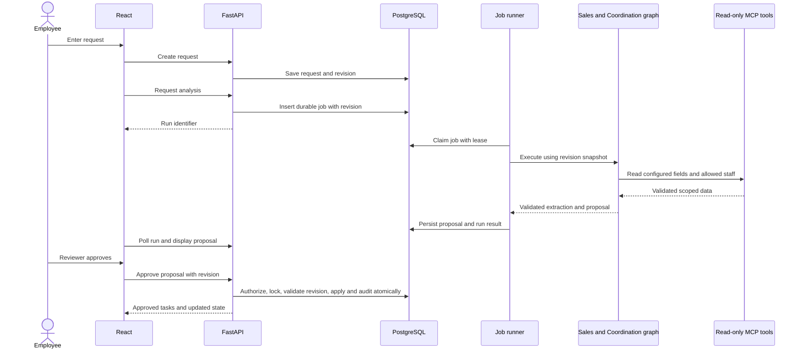

# Proposed architecture

Status: design proposal. No services, schemas, integrations, or deployments exist yet.

## Components and boundaries

| Component | Responsibility | Proposed technology |
| --- | --- | --- |
| Web UI | Request forms, review screens, task and activity dashboard | React with TypeScript |
| API | Authentication, authorization, validation, request lifecycle, approval transactions | Python, FastAPI, Pydantic |
| Database | Requests, revisions, jobs, proposals, tasks, audit records | PostgreSQL; migrations with Alembic |
| Job runner | Durable queue polling, leases, retries, graph execution | Separate Python process, PostgreSQL-backed queue |
| Business agent graph | Sales extraction followed by coordination proposal | LangGraph candidate; DeepAgents alternative |
| Tool gateway | Narrow, schema-validated read access to business profile and staff directory | MCP server/client integration |
| Model adapter | Provider credentials, timeouts, structured outputs, usage metadata | Provider to be selected |
| Observability | Traces, redacted logs, service/queue metrics, dashboards | OpenTelemetry, Prometheus, Grafana |
| Delivery | Local stack, tests, release and rollback | Docker Compose, GitHub Actions; hosting undecided |

The API owns mutations. Graph nodes return structured proposals and cannot commit tasks, change roles, or approve work. MCP permissions are enforced by server-side identities and tools, independently of model instructions. The on-call agent is a separate operational service with a narrower staging-only action surface.

## Data flow

Rejected proposals are retained with the review reason. Failed runs retain sanitized error metadata and do not produce active tasks. Polling is sufficient for the MVP; streaming is deferred.

## Proposed data model

- `business_profiles`: sector terminology, required extraction fields, timezone, version. MVP has one active business context per deployment.
- `users` and `role_assignments`: identity references and explicit permissions.
- `requests` and `request_revisions`: current status plus immutable input snapshots and profile version.
- `agent_runs`: request/revision, graph and prompt versions, execution state, lease, attempts, timestamps, correlation ID, provider metadata, sanitized error.
- `proposals`: run reference, typed extraction and task proposals, approval state, source revision, reviewer and decision metadata.
- `tasks`: approved proposal reference, title, owner, deadline, state, cancellation reason.
- `audit_events`: actor identity/type, action, target, timestamp, correlation ID, and minimized change metadata.
- `operational_incidents`: fault exercise, diagnostic evidence references, authorized action, approval, execution and verification result.

Use relational columns and foreign keys for lifecycle and ownership; versioned JSON payloads are appropriate for evolving extraction schemas. Audit records must exclude raw secrets and unnecessary customer content. Retention and deletion policy must cover snapshots, provider payloads, backups, and audit metadata together.

## Reliability and consistency

Persist jobs in the same database transaction that accepts analysis. Workers claim jobs with locking and renewable leases; abandoned leases become retryable. Retry transient provider/tool failures at most twice with backoff, respecting a configurable 120-second overall run deadline. Permanent validation failures terminate visibly.

Assume at-least-once execution. Use run identifiers, unique proposal-per-run constraints, idempotency keys, and transactional state transitions to prevent duplicate effects. Approval locks the proposal and request, checks revision and role, applies tasks, and writes its audit event in one transaction. Duplicate approval requests return the existing result. Re-analysis supersedes older pending proposals; a worker must check freshness before publishing results. Historical approved proposals remain immutable.

## Observability and recovery

Propagate correlation IDs across API, jobs, graph nodes, and tool calls. Record latency, errors, queue depth/age, run outcomes, and approval counts. Use low-cardinality metric labels; do not label metrics with customer/request identifiers. Store diagnostic identifiers in access-controlled logs or traces instead.

Prometheus evaluates the queue-age alert; an alert routing component and notification destination remain to be selected. Grafana shows user-facing API performance and agent processing delay. Trace storage and telemetry collector topology remain open decisions.

The controlled staging failure pauses worker processing through a dedicated fault flag. The on-call agent reads redacted telemetry, proposes resetting that exact flag, waits for operator approval, executes once, and verifies completion using a synthetic probe. It has no arbitrary shell, production write access, credential rotation, data deletion, or code deployment capability.

## Security and deployment

Use backend-enforced role checks, HTTPS for public access, scoped service identities, managed secrets, and explicit CORS origins. Authentication approach and browser session protections must be decided before implementation. Apply the boundaries in [permissions.md](permissions.md).

Compose should define the frontend, API, worker, PostgreSQL, MCP service, and an optional observability profile. Public hosting must support durable jobs and persistent PostgreSQL; database ports remain private. Migrations are a controlled release step. Record backup, restore, health/readiness, rollback, resource limits, and model budget procedures before public use.

## Open architectural decisions

1. LangGraph versus DeepAgents: evaluate structured state, durable execution needs, tool permissions, and testability with one synthetic workflow; record an ADR before adopting a framework.
2. Model provider/model: compare structured-output reliability, cost, latency, retention, and regional data handling; select with a small documented evaluation.
3. Authentication: managed OIDC versus application sessions; specify provisioning, session expiry, CSRF protections where applicable, and role storage.
4. Hosting and delivery: choose a low-cost HTTPS target, secret store, persistent database, migration process, and rollback strategy.
5. Telemetry: select trace/log storage, alert routing, retention, and who receives operational alerts.
6. Pilot policy: confirm required fields, role assignments, deadline rules, data retention, lawful processing arrangements, and whether real pilot data may enter a selected provider.
7. Extension Pack: verify official Module 5 requirements and map each selected extension to tests, documentation, and permission changes.

Later decisions belong in `docs/decisions/` as numbered ADRs; that directory and its records are not created yet. See [plan.md](plan.md) for decision gates.
