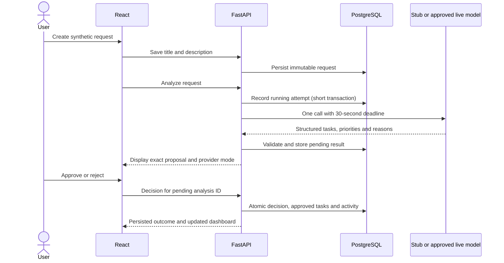

# Minimal final-project architecture

Owner: [T03](https://github.com/chakirou18/AI-OfficeFlow/issues/3). Current decision: [ADR 0010](adr/0010-minimal-zoomcamp-scope.md). Older ADRs 0001–0009 are superseded design history, not implementation requirements. This is target design except for the explicitly verified T04 foundation below.

T04 implementation note: the four-service local foundation (frontend, API, PostgreSQL and one-shot migration) is implemented and verified on its feature branch. It exposes only health and fixed synthetic `foundation_checks` save/read endpoints. [development.md](development.md) gives working commands; [t04-verification.md](t04-verification.md) records tests, real restart persistence and clean-source startup. The application entities/flows, sessions, analysis and telemetry/on-call architecture below remain target design, not implemented T04 features.

## Components and flow

| Component | Minimum responsibility |
| --- | --- |
| React + TypeScript + Vite | Create/list/detail requests, show task/priority suggestions, approve/reject and dashboard. Serve a static build through a same-origin proxy in deployment. |
| Python + FastAPI/Pydantic | Session protection, JSON/OpenAPI contract, validation, one synchronous analysis workflow, PostgreSQL transactions and private ops interface. |
| PostgreSQL + SQLAlchemy/Alembic | Durable requests, analyses, approved tasks, sessions, decisions/activity and small demo operational state. |
| Model adapter | Deterministic offline stub plus a provider-neutral live adapter configured only after authorized provider/model evaluation. |
| OTel Collector + Prometheus/Loki/Tempo + Grafana | Collect/store/display correlated metrics, structured logs and distributed traces. |
| Prometheus rules + Alertmanager | User-impact analysis-error alert and authenticated internal delivery. |
| Custom on-call agent | Separate bounded webhook listener/diagnostic loop; clears only a pre-authorized dev analysis flag and verifies recovery. Also the selected Module 5 custom-agent artifact. |
| Read-only MCP stdio tool | Small local Extension Pack tool such as get_request_summary for synthetic data, using a read-only API scope; no network MCP platform needed. |

The application does not need LangGraph/DeepAgents, two business agents, an extra worker, message broker, durable queue, leases, cancellation, streaming, editable requests, business profiles or enterprise roles. Module 5 MCP is separate from the app's model call. An alert/on-call component remains separate because actual alert-driven diagnosis/repair must be demonstrated.

## Data and consistency

| Entity | Minimal fields / rules |
| --- | --- |
| demo_accounts / sessions | Pseudonymous account, password hash, opaque hashed session token and expiry. No signup/admin/role-management UI. |
| requests | ID, immutable title/description, creator handle, display status, timestamps. |
| analysis_runs | Request ID, state, prompt/schema version, provider mode, structured suggestions, idempotency key, start/deadline/end, sanitized error and human decision metadata. |
| tasks | Analysis ID plus suggestion index (unique), title, priority, open/done and timestamps. Only created in approval transaction. |
| activity_events | Minimal actor/action/target/time for decisions, task changes and operational actions; no full prompt/body copies. |
| demo_settings / incidents | Dev-only analysis flag, exercise authorization boundary, alert fingerprint/start, repair attempted/outcome. No separate operational workflow platform. |

Use foreign keys, a unique analysis/idempotency key and a constraint allowing at most one running/pending analysis per request. No database transaction stays open during model I/O. Requests cannot be edited, so there is no revision/stale-input subsystem. Approval locks request then analysis, checks pending state/authentication and applies task inserts, decision and status together. Duplicate approval returns existing tasks; a contradictory decision returns conflict.

Analysis is synchronous and bounded at 30 seconds, without automatic retry. Persist the run before calling the adapter. Timeout/schema/provider failure marks it failed with no tasks. On API restart, running attempts whose deadline passed become interrupted/failed; no job resumption promise. A user retries explicitly with a new attempt key. A late response cannot publish after its attempt deadline/state has changed. This is intentionally sufficient for a small demo, not a high-throughput service.

## Security and model behavior

All demo accounts have equal permissions in one shared synthetic workspace. Use existing libraries for password hashing and opaque server sessions; cookies are HttpOnly/SameSite, Secure over public HTTPS, with CSRF/Origin checks for mutations. Only explicit loopback mode may relax Secure. Initial credentials come from untracked configuration; never seed a universal password. Bind private service ports internally.

The analysis agent produces 1–5 proposed tasks, each with priority low/medium/high and a rationale. Python validates the schema and output size. Model text cannot activate tasks or invoke ops tools. The UI escapes text. No owner/deadline extraction, company policy, external tool loop or business-side effects.

Stub mode supports one-command boot/tests without a model key and is labeled simulated. T10 must separately demonstrate a real approved model; the stub alone does not finish the AI feature. Live provider/model and usage allowance are a T10 decision, not a blocker on architecture or local scaffolding. Before live calls: approve provider/data settings and a bounded call allowance; cap input/output tokens, concurrent calls and per-call duration; persist consumed call allowance before dispatch so restarts do not reset it. Failed/uncertain billed calls consume their allowance. No automatic provider failover. Exact live prices/quotas are not assumed, and no live call/spend is authorized now.

## Observability and actual repair

API/model-adapter/HTTP spans export through OTel Collector. Include trace_id/span_id in structured logs; propagate trace context across proxy/API and Alertmanager/on-call/ops calls for the recorded journeys, with explicit links where an alert begins a new trace. Store metrics in Prometheus, logs in Loki and traces in Tempo; expose all in authenticated Grafana. Metric exemplars/drill-down link to traces without high-cardinality labels. Do not export descriptions, model prompts/results, passwords, cookies or tokens.

The user-impact alert is analysis HTTP 5xx ratio >50%, at least five attempts in the prior two minutes, sustained for one minute. During a later authorized dev exercise, analysis-disable produces 503 before any model call; synthetic analysis requests generate the measured impact. Alertmanager calls the on-call listener automatically with a scoped credential. The agent deduplicates by fingerprint/start, checks dev environment/exercise authorization and diagnostic flag, records one repair attempt, clears only that flag, then invokes a bounded synthetic analysis-health check using the same service. Record a successful user analysis after repair too.

The exercise's human authorization pre-approves only this one action for a bounded dev exercise; no additional per-incident approval UI is needed. It does not authorize task approval or production remediation. Unknown cause, disabled exercise, duplicate action, expired authorization or failed verification stops/escalates. No shell, code patch, deploy, secret rotation or database deletion. Fault execution remains unauthorized during this documentation task.

## Boot, tests and delivery

Planned commands (no Compose/scripts exist): `docker compose up --build` starts the complete demo including PostgreSQL, migrations, app, observability, alerting and listener; `docker compose --profile test run --build --rm test` runs unit/integration suites against isolated PostgreSQL. The fault/repair action is disabled by default. A documented lightweight profile can later support feature development; it does not replace full-stack startup evidence.

PR CI runs deterministic tests/checks. A successful trusted main release builds immutable images and automatically deploys the same release to `dev`. A separate manually initiated production workflow promotes its tested digest. Use separate Compose projects/databases/volumes/secrets/origins, environment deployment locks and protected credentials. No secrets in untrusted PR jobs.

Choose Compose-compatible deployment, with public hosting account/region/budget finalized in T16; an actual deployment on existing approved infrastructure plus a clear recording is the rubric-permitted fallback. Dev/production are release environments using synthetic data, not real businesses. Do not assume a free tier. Before any paid hosting, obtain approval and a current quote. Promotion runs migrations, health and synthetic smoke checks. Roll back to the previous schema-compatible image; use additive migrations, and do not automate database downgrade or volume deletion. Rehearse a small isolated backup restore rather than building an enterprise backup platform.

## Next steps and decision boundaries

T03 is a documentation/design task, not procurement or runtime validation. Its current selections are a single Python workflow, bounded stub/live adapter, simple session protection, local Compose/deployment contract and stored telemetry. External account selection belongs to T10/T16; it does not block T04. T04 is the next implementation slice: minimal frontend/API/PostgreSQL/migration/health/Compose skeleton, then early CI in T05. Preserve all existing task dependencies; full T04 acceptance still needs actual startup evidence.

All seven Module 5 items and three peer reviews remain in the roadmap. T15 must obtain exact exercise authorization; T17 must select a supported subagent runtime and get invocation authorization. No code, dependency installation, paid service or deployment is authorized by this architecture revision.
