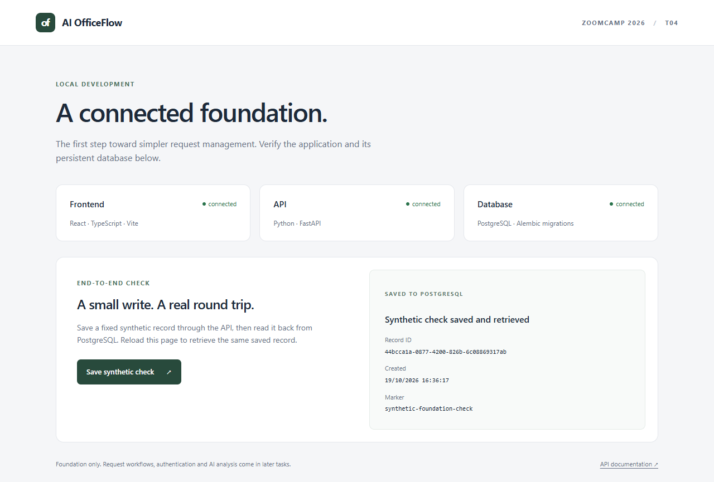

# T04 verification record

Issue: [#4](https://github.com/chakirou18/AI-OfficeFlow/issues/4). Branch: `feat/t04-full-stack-foundation`. Runtime/source commit tested: `49662db95f8bd98a340c50438096111bb58210e3`. Documentation-only follow-up changes do not alter the tested implementation. No merge or issue closure is claimed; review is pending.

## Starting state and scope

Inspected the clean working tree, recent history, remote branches and issue criteria before writing code. Local/remote main matched `bcb6182408432dde0ee9ef4f6b1b161d5b3cbc73`. No frontend/backend/Compose/migrations, feature branch or PR existed. T03 was closed with design evidence. Only missing T04 foundation work was implemented.

Implemented React/TypeScript/Vite, FastAPI, SQLAlchemy/psycopg/PostgreSQL, an Alembic migration and ordered Compose boot. A dedicated `foundation_checks` table and fixed-payload endpoint prove connectivity without introducing T07 request management. Config is generated locally, API/frontend bind only to loopback, database has no host port, and runtime containers run as non-root app/web users. The initial PostgreSQL role is a local development bootstrap role, not production least-privilege evidence.

## Executed checks

| Command / check | Actual result |
| --- | --- |
| `python scripts/configure_local.py`, repeated | Created ignored `.env` without printing the random password; second run preserved it |
| `docker compose config --quiet` | Passed configuration validation without displaying expanded secrets |
| `docker compose up --build` | Built and started db/migrate/api/frontend; db/api/frontend healthy and migration exited 0 |
| Frontend `/`, proxied liveness/readiness and direct OpenAPI | HTTP 200; readiness included database ok and revision `0001_foundation` |
| `docker compose exec -T api alembic current` / `alembic check` | Head `0001_foundation`; no new upgrade operations |
| `docker compose --profile test run --build --rm test` | **5 passed in 1.11s**: 2 unit, 3 real-PostgreSQL integration; 1 upstream TestClient/httpx deprecation warning |
| `npm.cmd --prefix frontend run build` | TypeScript check and Vite production build passed on host and in Docker |
| `BROWSER_CHANNEL=msedge` then `npm.cmd --prefix frontend run test:e2e` | **2 passed in 3.6s** in installed headless Edge; database save/read/reload and explicit HTTP 503 feedback; no page errors |
| `python scripts/verify_persistence.py` | Identical record `e7767c71-9d2a-470b-8ea4-36c274a3860e` before/after db/api restart; ID, fixed marker and timestamp matched |
| Stop/resume main stack | `docker compose stop frontend api db` then `docker compose up -d --wait` succeeded without deleting the volume; migration rerun exited 0 |
| Staged source secret exclusion | `.env`, node_modules and artifacts ignored; generated local password absent from every staged file; only placeholder example committed |

The integration suite checks the migrated database/readiness, committed API write from an independent SQLAlchemy session, API readback, and unknown/invalid ID errors. Unit tests distinguish liveness from database health and verify sanitized 503 errors without driver details. No SQLite substitution or passing test result was invented.

## Clean tracked-source startup

Exported commit `49662db` with `git archive` to a new ignored directory, without `.env`, node_modules or other untracked files. Generated a new password there, then ran:

```text
docker compose --project-name officeflow-t04-clean49662db up --build -d --wait --wait-timeout 120
```

Used isolated ports 9080/9000, network and PostgreSQL volume. The clean build installed locked dependencies, automatically migrated a fresh database, made all three services healthy and completed a frontend-proxied synthetic write/read: `f4873f95-4875-4d54-a823-e8bcc62fa2e7`. This was real container execution from tracked source, not just a configuration parse. The verification project's containers/network were then removed with `down`; its volume was preserved and the main review stack was not removed.

## Failures and fixes

1. Sandboxed Docker/uv cache access was denied, and sandboxed npm resolution stalled. Authorized host execution succeeded; no OS/tool installation was required.
2. The first Docker build was started before npm finished generating `package-lock.json`, so COPY failed. Dependency installation completed before retrying. This was an execution-order error, not a successful build.
3. TypeScript reported TS2882 for the CSS side-effect import. Added `src/vite-env.d.ts` with Vite client types; host and container builds then passed.
4. The passing backend run emitted one Starlette TestClient/httpx deprecation warning. No test failed; the pinned dependency set retains that warning. The browser run also emitted a harmless NO_COLOR/FORCE_COLOR console warning.

## Reviewed screenshot and limits



The screenshot's record is the separate browser-test record, not the restart-check ID above. Only fixed synthetic content is shown. The screenshot and persistence JSON contain no configuration secrets. The ignored clean-verification directory has its own generated `.env`; never publish or attach the entire artifacts directory.

T04 acceptance is demonstrated, but #4 remains open and the PR remains unmerged for review. Authentication, request/task models/UI, AI, CI/CD, observability, alerts, on-call, MCP and later product test coverage are not implemented. Passing foundation suites do not close T05/T12 or establish grading points. No public deployment or external service was provisioned.
